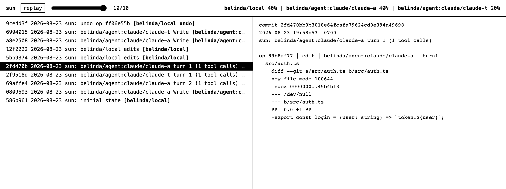

# sun

Sun is an operation log on top of git. It records who made every change, whether that was you
or a specific agent session. Rules in `RULES.md` say what should hold for the work, and checks
record who verified what, so a pull request can say what a person, a program, or a model has
looked at. Raw conversations stay local unless you explicitly share them.



## One command

```sh
uv tool install git+https://github.com/sundial-org/sun
cd your-repo && sun init   # sets up every harness it detects (Claude Code, Codex)
```

`sun init` scans sessions that touched this repo for each harness it detects. Worktrees and
subagents are included. Raw transcripts remain in their existing local directories by default.
Existing commits stay untracked because sun did not observe them: work done before `sun init` is
one initial snapshot, and agent sessions already running are recorded from their next restart,
since a harness reads its hooks when a session starts. From then on, hooks keep an
independent Sun history current: one visible commit per turn, containing one operation per
agent tool call. Each operation keeps a hidden Git snapshot for exact replay and undo. Human
edits observed during a turn remain separately attributed operations inside that turn commit.
Sun commits share Git's object database but never move normal `HEAD`
or the real index, and they do not appear in GitHub's branch history. Codex asks you to review
and trust new project hooks through `/hooks` before it runs them.

Each Git branch has a corresponding Sun branch under `refs/sun/heads/<branch>`.
`sun init` installs Git branch-creation and checkout hooks for `git branch`, `git switch -c`,
`git checkout -b`, and `git worktree add`. Creating a branch from a named
local branch copies that branch's Sun pointer immediately, even if Sun is not run on the new
branch until later. Creating it from `origin/main` copies `refs/sun/remotes/origin/main`
instead. Subsequent edits advance only the selected branch. `main` and `master` work alike.
Fetching updates remote Sun pointers without moving local Sun branches.

Linked worktrees share branch history and repository settings. A new worktree needs no
second `sun init`: checkout installs its agent hook configuration and creates private hook
bookkeeping. Active calls, turns, and temporary indexes are never copied from another
worktree. Removing a worktree leaves its branch history intact. Checkout differences are
recorded as observed state with unknown authorship, before later edits are attributed.
When a pull matches the observed HEAD reflog transition, Sun labels it with the
pull command and records the reflog's Git name and email. That identity is not
proof of who operated the shell. The executor stays unknown unless an exclusive,
paired agent shell call names the matching pull. Imported file authorship remains
unknown. Missing or ambiguous reflog evidence keeps the generic observation label;
existing history is not relabeled.

Inheritance uses the creation source recorded in Git's branch reflog. An explicit commit
SHA has no unique Sun branch; it starts an independent history at that Git tree. If creation
hooks or reflogs are disabled or bypassed, Sun cannot recover the exact source later. It
reports the missing source and starts from the Git checkout instead of guessing from equal
commit IDs or rebuilding from transcripts.
Branching before the first Git commit requires Git 2.50 or newer, which reports symbolic
HEAD transactions. With older Git, make an initial Git commit before branching.
Git branch copy/rename commands are not covered by these creation hooks. Detached HEAD
is unsupported. Do not switch branches during a tool call.

Git hooks are dispatched from the common Git directory's `sun/hooks`; existing hooks,
including a configured `core.hooksPath`, are delegated to without editing their files.
`sun sync` and agent hooks record locally. Normal Git commits and merges do not record
checkpoints. The dispatcher also publishes recorded Sun history for each branch pushed by
`git push`; a failed Sun push warns without blocking the Git push. Use `sun init` again if you
replace `core.hooksPath` and want to reconnect Sun.

`sun push [remote] [branch]` publishes **already recorded Sun history only**, independently of
Git commits. The default is origin/current branch. It does not run sync, require a clean worktree,
or push a normal Git branch. Use `git push` separately for normal Git history. Uncommitted edits
that Sun has recorded are publishable; edits not yet recorded are not included.

Fetching does not join histories. When publishing, Sun combines the selected branch's local
and fetched Sun ancestry, preserving original operation IDs and keeping the local snapshot.
This is a history join, not a file merge: it neither applies remote files nor resolves conflicts.
Resolve file conflicts through normal Git once, then run `sun sync` to observe the result.
A `merge` operation in Sun describes this history join, not a mirrored Git merge commit.
There is no separate `sun merge` conflict-resolution workflow.

Git feature-branch merges do not automatically link the feature's Sun ancestry into the target
branch. Each branch retains its own recorded history; Sun observes the target's resulting files.
Automatic cross-branch provenance is deliberately deferred rather than inferred from Git commits.

Only the selected Sun history's reachable operations and snapshots travel in one atomic push,
without force. Unrelated Sun branches stay local. If sharing raw sessions is enabled, your latest
stored versions of sessions referenced by that history also travel. Raw sessions are not redacted
or bounded by a Git commit: they may include later conversation or other branches.

Published operations and operations inherited by another local Sun branch are not squashed.
Interleaved turns may also remain separate commits. Atomic pushes require server support and
are never retried non-atomically. A concurrent push rejection can be retried: Sun fetches and
joins the additional history without changing your files. Recorded attempts and undone edits
remain part of published history; Sun is not a secret-redaction tool.
`sun log`, `sun show`, `sun blame`, and `sun viz` read this history. Only the first person in a
repository runs `sun init`: it writes the harness hook configuration, which is committed. Every
clone and worktree of a repository with that configuration sets up its own state, fetch refspecs,
and pre-push hook on its first Sun command or hook, and a new worktree's branch inherits the Sun
history of the branch it was created from, observing any differing files rather than crediting them
to you. An agent never has to edit `.claude/settings.json`.

Operations have full unique IDs and separate refs under `refs/sun/events/`, so two computers
using the same Git identity cannot overwrite each other's event logs. Operation metadata and
the local history tip are updated in one Git transaction. History is ordered by ancestry,
then operation order within a turn, not by wall-clock timestamps on different machines.
Concurrent branches have no implied total chronological order.

Hooks support concurrent writes to different files. Overlapping writes, failed partial writes,
and edits recovered after an interrupted call are marked uncertain instead of assigned to an
agent by guesswork. Stop, session end, or a new prompt releases abandoned claims. Re-running
a completion hook is safe. If a process disappears without any closing hook, stop the agents
and run `sun sync --recover` to release abandoned calls and record uncertain edits.
Sun cannot detect a human typing into the same file during an
agent write; use separate worktrees if precise ownership of overlapping edits is required.

## Use the history

| command | what it does |
| --- | --- |
| `sun sync` | record local changes since the last Sun snapshot; never fetch or publish |
| `sun log [-n COUNT]` | list Sun commits with actors and turns |
| `sun show <commit>` | show a commit's operations and patches, including hidden operation snapshots |
| `sun data [-n COUNT]` | JSON history, attribution, patches, and resolved session paths for agents |
| `sun viz [-n COUNT]` | interactive terminal history for humans |
| `sun viz --html [-o path]` | optional self-contained HTML export |
| `sun blame <file> <line>` | show the operation and stored conversation behind a line |
| `sun undo [--op ID \| --commit HASH]` | cleanly reverse an operation or commit as a new operation |
| `sun undo --dry-run` | check whether the latest reversal can apply without changing anything |
| `sun restore <commit>` | restore an older Sun state as a new commit without rewriting history |
| `sun push [remote] [branch]` | publish the selected Sun history, separately from normal Git |
| `sun check RULE VERDICT` | record your own verdict on a rule ([below](#check-the-history)) |
| `sun check --run [RULE ...]` | run the rules that name a command, model, or agent, and record their verdicts |
| `sun coverage [-n COUNT] [--json]` | see which commits were checked against each rule, and by whom |
| `sun extract` | record the verdicts you gave your agents in conversation |
| `sun pr [--update]` | summarize checks for the pull request as Markdown, or write it into the PR |
| `sun trust` | let hooks on this machine run the commands `RULES.md` names |
| `sun export [-o path]` | export prompts, tool calls, and edits as JSONL |
| `sun update` | update a Sun installation made from this repository with uv |

`sun data` emits one JSON object, including `commits`, `events`, `actors`,
`sessions`, and `summary`. Each operation includes `session_path`; session entries include
`id`, `user`, `harness`, `origin`, `path`, `subagents`, and `ref`. Read `path` directly:
it points to your native transcript or a cached collaborator transcript. A missing native
transcript has a null path, even if you previously shared it. Shared Git refs remain available
through `sun sessions show`. No terminal is required, including with stdin from `/dev/null`.

`sun viz` opens the terminal view. Use `j`/`k` to move through commits, `J`/`K` to scroll
details, left/right to move the replay boundary, `r` to replay from the beginning, and `q` to
quit. Each commit shows its native git author alongside Sun's observed actors. Operation
details identify the human or agent that generated them, including harness, session, turn,
tool call, attribution method, files, and patches. A `sync` attribution means a Sun command
discovered an uncaptured dirty edit later. It does not mean an agent hook observed the edit
when it happened.

Undo can target any stored operation or ordinary single-parent Sun commit, not only the latest
one. It stops without changing files if the reverse patch no longer applies cleanly. Restore is
the safer way to return the whole worktree to an earlier point: it preserves the existing log and
adds a restoration commit. Neither command rewrites or deletes history.

## Check the history

The operation history is what happened. Rules, checks, and coverage are what someone concluded
about it. They are kept apart on purpose: a check can be wrong, so it never edits the history.

The flow, end to end: the team writes `RULES.md`; `sun init` installs the hooks, and a person runs
`sun trust` once to let them run the commands it names. A person prompts and the agent works for hours: rules marked `on: call` run
after each edit and rules marked `on: turn` run when the agent stops, failures go back to the
agent once per turn, and the agent can run `sun check --run` itself before it stops. The person
reads the result and replies; at the end of that turn, `extract:` turns explicit judgments in the
reply into checks that cite the state the person saw, and `sun check RULE VERDICT` records a
terminal verdict. `sun coverage` shows the table, and `sun pr --update` puts a section in the pull
request saying what was checked, by whom, at which granularity, and what nobody has looked at.

A **rule** is a `## name` section of `RULES.md` at the repository root, committed like any other
file. Its text says what should hold for the work. A rule may also say what runs it, in a `---`
block right under the heading:

```markdown
---
extract: haiku          # optional: at the end of each turn, read your reply for verdicts
---
## use-current-results
Every result cited in the paper agrees with the latest corrected experiment.

## lowercase
---
run: scripts/lowercase.sh     # a command: exit 0 is pass, anything else is fail
on: call                      # run it after every agent tool call that changed a matching file
files: "*.md"
---
Every sentence starts with a lowercase character.

## code-style
---
agent: haiku                  # an agent with read-only tools and a fresh context
on: turn                      # run it at the end of every agent turn that changed matching files
files: "src/**/*.py"
---
Code follows docs/style.md.
```

`run:` names a command. Sun runs it in the repository root with `SUN_AT` (the Sun commit being
checked), `SUN_SINCE` (the base of the diff), `SUN_FILES` (the changed files, one per line), and
`SUN_RULE`. Its exit status is the verdict and its output the note, unless the last line is a JSON
object `{"verdict": ..., "note": ..., "cites": [{"file": ..., "lines": [a, b]}]}`. `model:` names
one model call with no tools: Sun writes the rule, the diff, and the changed files on its stdin and
reads a JSON verdict from the reply. `agent:` is the same contract for an agent with read-only
tools and a fresh context. A bare name such as `haiku` runs through your harness CLI (`claude -p
--model haiku` or `codex exec -m haiku`); a value with a space is a command of your own. A rule
that names none of these is prose: people check it, or programs pipe checks for it.
`feedback: false` keeps a failing verdict from being sent back to the agent. A legacy `RULES` file
of `name: text` lines still works.

A **check** is one verdict on one rule. It must cite the recorded state it read: a Sun commit or
tool-call snapshot, optionally a file and lines in it. A judge model, a program, and a person all
write the same shape:

```sh
sun check --run                                # every rule that names a command, model, or agent
sun check --run code-style --since HEAD~3      # some of them, against a range of Sun commits
sun check use-current-results fail -m "notes report 12 points; corrected result is 2"   # you, at a terminal
echo '{"rule": "use-current-results", "verdict": "fail", "actor": "program:cite",
       "cites": [{"at": "4e02d88", "file": "notes/results.md", "lines": [1, 2]}]}' | sun check   # a program
```

`sun check --run` prints one line per rule and exits 1 when a verdict is not `pass`, so an agent
can run it before it stops and fix what failed. Rules with `on: call` or `on: turn` also run from
the harness hooks, and a failing verdict goes back to the agent once per turn as the hook's reason,
so it keeps working. A later run of the same rule in the same turn replaces the earlier verdict
rather than leaving the turn `mixed`; a rerun replaces only a verdict from the same turn whose
files it covered. Hooks, and agents' shells, run the commands in `RULES.md` only after a person
runs `sun trust` on that machine, and again after those commands change, so a commit from someone
else cannot start programs or spend model credits there; `sun init` lists what `RULES.md` would
run instead of trusting it for you. A judge runs outside Sun's lock with `SUN_CHECKING` set, so
its own hooks record it but run no rules, and an `agent:` judge gets read-only tools.

The verdict is any short word the task needs. `actor` is required on stdin and stored as
`<git user>/<actor>`; `local`, `chat`, and harness session actors are Sun's own and cannot be
declared. Every check also records `via` (`terminal`, `stdin`, `run`, `hook:Stop`, `hook:PostToolUse`,
or `extract`) and, when an agent tool call was in flight, `from`, the session that recorded it.
A check's ID is the hash of its content, so recording the same check again returns the original,
and `sun check` never overwrites one. A **review** is a check that cites another check,
`{"cites": [{"check": ID}]}`, and replaces it in coverage. At a terminal, give the printed ID:
`sun check use-current-results fail 0286c3a1`.

`extract: MODEL` in the front matter turns your replies into checks. At the end of each turn, one
model call reads the reply that started it, the agent's last message before it, and the rules, and
reports only explicit verdicts, quoting your words. Sun records each as `<git user>/chat`, citing
the state you were looking at when you replied, and drops anything that is not a verbatim quote.
`sun extract` does the same on demand for every session seen in this checkout, and `sun pr` reads
unread replies first when the model is trusted. What a harness or a hook injected into the
conversation is never read as the person's words. `sun show <check id>` prints one check.

`sun coverage [-n COUNT] [--json]` folds checks onto Sun commits. Each commit and rule is
`unchecked`, the verdict, `mixed` when checkers disagree, or `outdated` when the rule changed since.
A row says `needs eyes` until a person's verdict counts, `chat only` when that verdict came from a
reply, and nothing when one came from a terminal, so a terminal review of a chat verdict promotes
it. A check written during a turn lands on that turn's commit once the turn is squashed. Coverage
is computed when you ask and stored nowhere.

`sun pr [--base BRANCH]` prints a Markdown section for the pull request: per rule, what was
checked on which Sun commits and by whom; then what a person checked at a terminal, what was said
in chat and not yet confirmed (with the quote and the command that confirms it), what the agent
checked on its own work, what only programs and models checked, what was checked before a rule
changed, and what nobody has checked. `sun pr --update` writes it into the open pull request with
`gh`. The section names who generated it, including an agent that generated it from its own shell.

What a line there means. `emma (terminal)` means a check with actor `emma/local` was recorded on a
machine whose git user is emma while no agent tool call was in flight and no agent shell was
detected; it does not prove Emma read the diff. `emma (in chat)` means a model read a reply in a
transcript and Sun kept the quote; confirm it at a terminal before relying on it. `model` and
`agent` lines are one model's opinion in a fresh context, `program` lines are a script's exit
status, and `self-check` means the session that made the change ran the check itself. Anything
fetched from a remote was written by whoever could push there. Sun records these claims and keeps
them from being overwritten; it cannot verify who made them. It is a record, not a security
boundary.

Checks are blobs under `refs/sun/checks/<git user>/`; a check stored under another user's name is
ignored. `sun push` and the pre-push hook publish yours before the history, and `git fetch` brings
in everyone's. Rejected check uploads warn and show Git's error while history publication
continues; checks remain local for retry. A check cites recorded files, not tool output, because Sun stores none. A failing
check's note is shown to the agent as text; Sun truncates it and nothing more.

## Optional raw session sharing

Pass `--share-sessions` to store raw transcripts under `refs/sun/sessions/*` and share them
with everyone who can read the git remote. This is off by default because transcripts may
contain prompts, tool output, file contents, environment data, and secrets. Shared sessions
stay outside normal branches and PR diffs, but collaborators can inspect them with git.

| command | what it does |
| --- | --- |
| `sun sessions list [--grep REGEX] [--contains TEXT]` | list or search transcripts already stored in Sun refs |
| `sun sessions show <id>` | print one transcript by full ID or unique prefix |
| `sun sessions import` | copy new or changed native harness transcripts into Sun refs when sharing is enabled |
| `sun sessions export` | index native paths and cache collaborators' shared transcripts under `.git/sun/sessions/` |
| `sun sessions prune --older-than DAYS` | delete your old local transcript refs and materialized copies |
| `sun sessions prune --older-than DAYS --remote` | also delete those refs from `origin` |

Your own transcripts are never materialized into the local session cache. Sun resolves their
native paths, including paths learned from hooks. Collaborator copies are separated by owner,
so identical session IDs do not overwrite each other. Export refreshes `sessions-index.json`
and removes legacy cached copies of your own shared sessions. Git transcript objects are still
stored when sharing is enabled so collaborators can fetch them.

Import does not reconstruct edit attribution or modify the operation history. It only stores
transcript copies for later search, blame, and export. Prune only selects refs owned by the current
Git user. Teammates' refs are left alone. Git may remove the now-unreferenced transcript objects
during a later internal garbage collection.

## Code map

The `sun/` package separates the main jobs:

| File | Responsibility |
| --- | --- |
| `cli.py` | Command arguments, initialization, hook installation, and updates |
| `git_store.py` | Git objects, refs, snapshots, and local state files |
| `history.py` | Branch history, events, turn squashing, publishing, undo, and restore |
| `hooks.py` | Agent hooks and before/after tracking for tool calls |
| `sessions.py` | Native transcripts and optional shared session storage |
| `checks.py` | Rules, check runners, reviews, and coverage |
| `output.py` | Log, show, blame, JSON, terminal, HTML, and training export |

Run source checkouts with `python -m sun` instead of `python sun.py`. The installed
`sun` command calls `sun.cli:main`. Modules use explicit imports so callers can
see which part of Sun owns a function.

Events are read from `refs/sun/events/`. The old `events.jsonl` and `refs/sun/log/`
formats are no longer imported or used to reconnect branch history. Existing old
data is left untouched; repositories that only have that data need an older Sun
version to migrate it before upgrading.

## Demos & tests

```sh
python3 examples/demo_init.py   # pick any repo you've used Claude Code on -> timed sun init
python3 examples/demo_fresh.py  # synthetic end-to-end story -> examples/demo.html
python3 -m unittest test_sun test_reliability.ReliabilityTest test_checks test_check_collaboration test_branches  # full test suite
```

Run `python3 -m unittest -v test_check_collaboration` for deterministic Layer 2
collaboration scenarios. Each test creates Alice, Bob, and Carol clones with a local
bare remote and CSV/report fixtures for totals, item counts, and TODO markers.
Checks use fixed verdicts and timestamps; no model calls or network services are needed.
The suite exercises sharing, reviews, retries, branch scope, turn squashing, concurrent
submissions, and partial publication failures.
