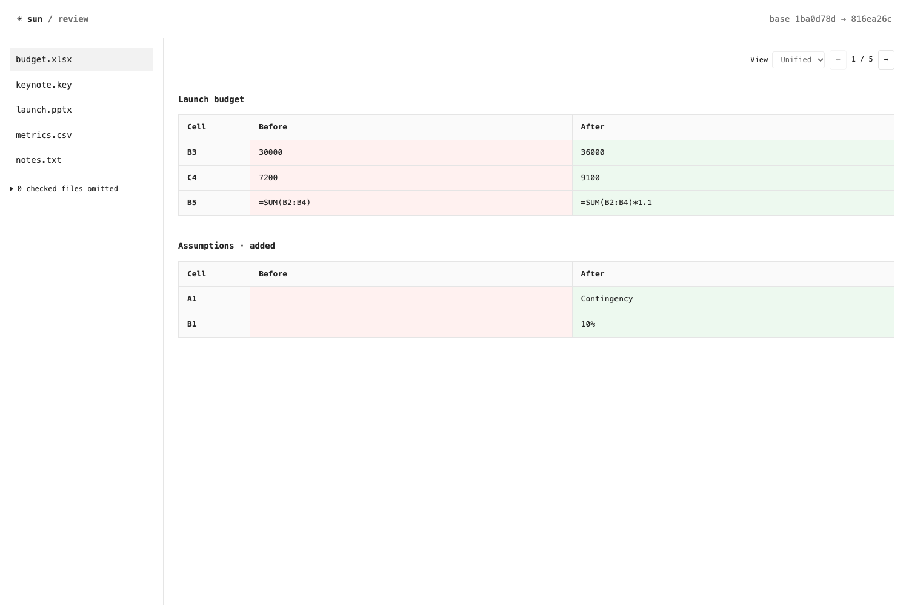
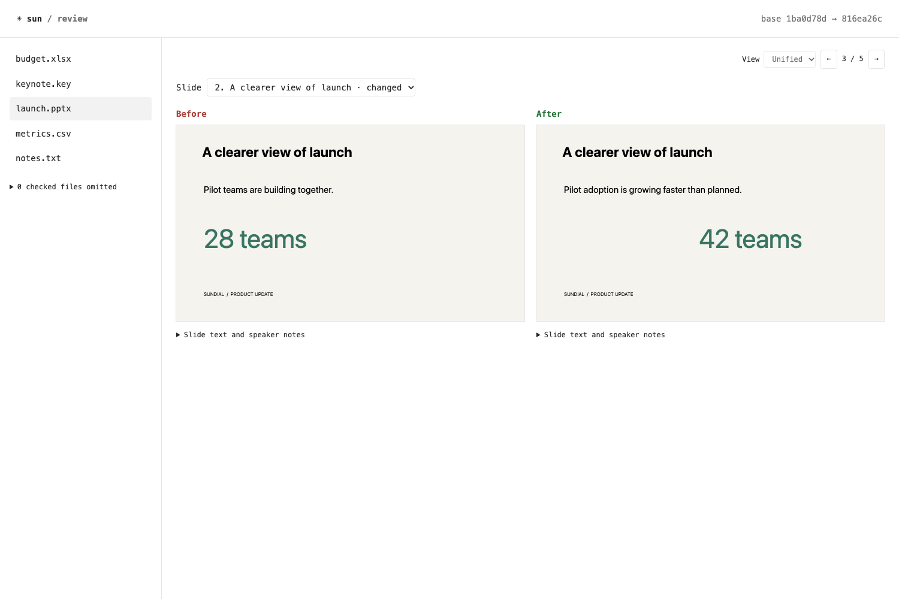

# Document diff demo

This demo uses synthetic launch plans, not user documents. Run it from the repository root:

```sh
python3 -m pip install -e '.[documents]'
python3 examples/demo_documents.py
```

The script creates an isolated temporary Git repository, records a baseline and revised files,
then opens the real `sun review --web` UI. It prints the repository path and URL and keeps
the example files after exit. Ctrl-C stops the server. Nothing is pushed.

- `budget.xlsx`: numeric changes, a formula edit, and an added sheet.
- `launch.pptx`: text/layout/note changes, reordered slides, and added/removed slides.
- `metrics.csv`: changed values and an added row.
- `keynote.key`: an explicitly labeled placeholder demonstrating the export-to-PPTX fallback.
- `notes.txt`: the existing Pierre code/text diff.





[Watch the recorded browser demo](demo.webm)

The ten-second video and screenshots are from the actual browser UI. These are review
previews, not native PowerPoint fidelity guarantees.

## Reproduce checks and recording

```sh
python3 -m unittest test_document_diff test_review test_review_web -v
python3 -m pip install playwright
playwright install chromium ffmpeg
python3 examples/check_document_demo.py --record /tmp/sun-documents-recording
```

Alternatively, pass `--channel chrome` to use an installed Chrome browser. The browser
check covers formulas, slide rendering and selection, added/removed slides, Keynote
fallback, text diffs, switching between files, mobile layout, and no external requests.
