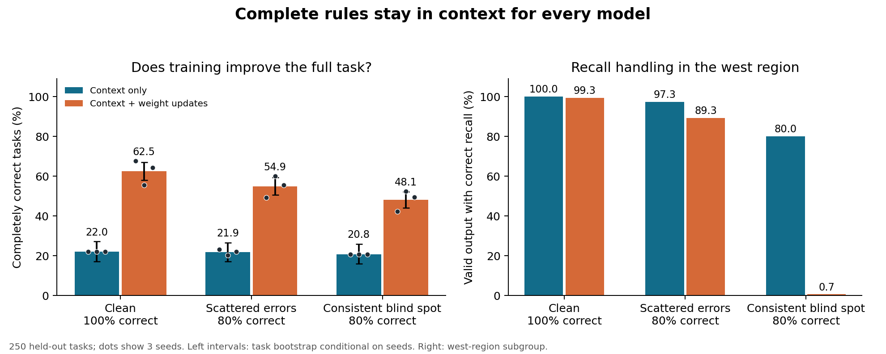
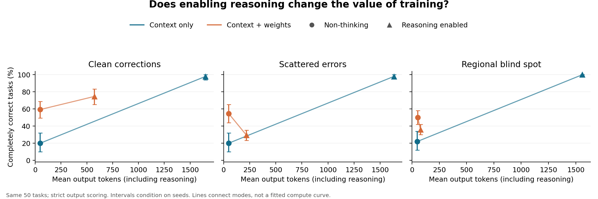

# Learning a Rubric from Imperfect Corrections

## Research question

When the complete correct rubric stays in context, does the pattern of equally frequent correction errors change the benefit of updating weights?

The experiment compares clean corrections with two archives that are each 80% correct: scattered mistakes and a consistent west-region blind spot. Every mistake ignores the recall override on one order. [M1]

## Method

Nine Qwen3-8B LoRA adapters use 400 shared training inputs, three epochs, and three seeds per correction condition. Evaluation uses 250 held-out three-order tasks. Frozen and trained models receive the same complete rules, checklist, and four retrieved examples. [M2]

All 95% intervals resample test tasks within region while holding the three training seeds fixed. They do not estimate uncertainty over new training runs. [M4]

## Results

| Correction source | Context only | Context + weights | Paired gain, percentage points [95% interval] |
|---|---:|---:|---:|
| Clean (100% correct) | 22.0% | 62.5% | +40.5 [34.1, 46.7] [R1] |
| Scattered errors (80% correct) | 21.9% | 54.9% | +33.1 [27.1, 38.8] [R2] |
| Regional blind spot (80% correct) | 20.8% | 48.1% | +27.3 [21.5, 33.1] [R3] |

The difference between the training gains under scattered and systematic errors is +5.7 [0.7, 10.9] percentage points. The prespecified practical-reversal criterion was not met. [R4]

| Correction source | All decisions correct, context | All decisions correct, trained |
|---|---:|---:|
| Clean (100% correct) | 50.8% | 87.3% |
| Scattered errors (80% correct) | 51.3% | 76.4% |
| Regional blind spot (80% correct) | 48.8% | 71.3% |

The decision-only measure ignores output ordering while retaining exact IDs, allocations, and routes; the primary measure additionally requires the requested order. [R5]

| Adding retrieved examples to the complete rules | Effect on frozen model | Effect on trained model |
|---|---:|---:|
| Clean (100% correct) | +20.8 [15.6, 26.4] | -8.3 [-12.4, -4.1] |
| Scattered errors (80% correct) | +20.7 [15.9, 25.7] | +7.7 [3.5, 12.0] |
| Regional blind spot (80% correct) | +19.6 [14.4, 24.8] | +15.1 [11.7, 18.5] |

The example-context effects compare the same models with four retrieved examples versus the complete policy/checklist alone, in percentage points of complete-task success. [R8]

The regional-error adapters correctly handle 1 of 150 west recall evaluations (0.7%), versus 80.0% for the frozen model. Of the failures, 143 are valid complete responses with the wrong recall decision and 6 are invalid responses. These are the same 50 tasks evaluated across three adapters, not 150 independent tasks. [R9]

## Additional controls

The following controls were specified after the frozen baseline was observed and before any trained test result was inspected. They do not replace the primary endpoint. [M3]

| Correction source | Reasoning context only | Reasoning + weights | Paired gain on 50 tasks [95% interval] |
|---|---:|---:|---:|
| Clean (100% correct) | 98.0% | 74.7% | -23.3 [-32.7, -14.7] |
| Scattered errors (80% correct) | 98.0% | 29.3% | -68.7 [-74.7, -62.0] |
| Regional blind spot (80% correct) | 100.0% | 36.0% | -64.0 [-70.0, -58.0] |

The reasoning control gives both policies a 4,096-token output allowance and uses the same 50 tasks and retrieved examples within each paired comparison. [R6]

With clean corrections on those same 50 tasks, the training gain is +39.3 [24.0, 54.0] points in non-thinking mode and -23.3 [-32.7, -14.7] points with reasoning enabled. Mean output length in reasoning mode is 1649 tokens for the frozen model and 574 for the trained models. This secondary comparison identifies a mode-dependent reversal, not an equal-cost threshold. [R10]

A post hoc wrapper check changes trained reasoning-mode success to clean: 74.7%, scattered: 56.7%, systematic: 50.0%. It removes only a whole code fence or a lone unclosed `<think>` tag followed entirely by JSON. The clean result is unchanged: among its 38 failures across three runs, 29 have correct decisions in the wrong order, 6 have invalid outputs, and 3 have valid outputs with wrong decisions. [R11]

| Model | Recall success, original west | Same order moved to north | Paired change [95% interval] |
|---|---:|---:|---:|
| Frozen model | 56.0% | 56.0% | +0.0 [0.0, 0.0] |
| Clean (100% correct) | 97.3% | 96.7% | -0.7 [-2.0, 0.0] |
| Scattered errors (80% correct) | 54.7% | 64.0% | +9.3 [1.3, 17.3] |
| Regional blind spot (80% correct) | 0.0% | 65.3% | +65.3 [63.3, 66.7] |

The region control changes only the recalled order’s region; its correct answer stays identical. It uses the complete policy and checklist without retrieved examples. [R7]

For the regional-error adapters, north-region recall success varies sharply by run (seed 31: 98.0%, seed 73: 0.0%, seed 127: 98.0%). Seed 73 produces 50 malformed responses; its zero score cannot be interpreted as 50 valid wrong recall decisions. The other two adapters recover correct recall handling on 49 of 50 pairs each. [R12]

## Interpretation and next vector

The primary test did not find opposite preferred strategies for the two equally accurate correction sources. It did find improved overall execution alongside a learned regional rule failure. The secondary reasoning control challenges the premise that this task needs weight updates: the frozen model already reaches 98% with clean examples on its 50 tasks. [I1]

**Proposed next vector:** Does the mode reversal survive training that explicitly preserves reasoning? Hold the 400 clean inputs and three seeds fixed, compare final-answer training with training on verified reasoning traces, and measure accuracy against actual inference-token use. If the reversal disappears, the present boundary mainly reflects the training recipe. If it persists, mapping the accuracy/compute tradeoff becomes the priority. A broader feedback-reliability threshold is premature.

## Scope and limitations

This study tests one synthetic task family, one fixed policy, one model, one training-data size, and one nonzero error rate. It does not locate a general data threshold, test generated rubrics, or establish cross-domain transfer. [L1]

The noisy archives match accuracy and corruption operation, but not the distribution of incorrect route labels. Consequently, any difference cannot be attributed solely to error predictability. [L2]

Fine-tuning supervises final answers in non-thinking mode. It does not teach reasoning traces or explicitly preserve reasoning behavior. The reasoning result therefore applies to this training recipe; it does not establish that fine-tuning generally harms reasoning. [L3]

The rule system has an ordinary executable solution. Recall-success measurements require a valid complete response, so malformed outputs count as failures. [L4]

## Verification and cost

The analysis replays 5,489 unique primary test responses and checks frozen source/data hashes, both task oracles, all completed training steps, and the additional control responses. Estimated token charges for this cycle, including development and controls, are $3.69; estimated cumulative charges including the earlier writing study are $21.12. [V1]

The previous writing paper and its frozen evidence remain unchanged. See [protocol](PROTOCOL.md), [nearest neighbors](NEIGHBORS.md), [interpretation limits](INTERPRETATION_LIMITS.md), and [claim justifications](CLAIMS.md).
